# Consumer Behaviour Analytics & Prediction

A six-page, dark-themed analytics app over a survey of 388 people in Bangalore about ordering food online
(Kaggle: `srisyra02/online-food-ordering-dataset`). It answers:

- **Dashboard** (home): an interactive one-screen view. It has a filter panel, KPI cards with sparklines
  compared against all respondents, and donut and bar charts where a click on a slice, bar or row filters
  everything. It also shows an age trend (line/bar), top pin codes, feedback and customer type, and a model
  summary. A full **dataset profile** at the bottom covers every column: its role, unique values, missing
  cells, and numeric summaries or level counts.
- **Project Report**: a plain-language walkthrough for teachers and reviewers. It covers the 5 project
  steps, what the data shows (Yes rate by group plus 7 association tests), the model results with every
  metric explained, which factors matter most, how many predictions are right, and the limitations.
- **Overview**: who is in the data, and what share say Yes?
- **Segments**: which groups differ on Output or Feedback?
- **Geography**: where are respondents, and does Yes vary by area?
- **Models & Predictor**: which algorithm predicts best (Logistic Regression, Random Forest, XGBoost),
  how sure are we, and what does a model say for one profile, step by step? (`/predictor` jumps to that section.)
- **Data**: what is in the file, what was cleaned, and is the target valid?

## Target and its caveat

`Output` is the target; the positive class is **"Yes"** (the respondent answered Yes to the survey's
online-ordering question). The models use seven inputs only: Age, Family size, Gender, Marital Status,
Occupation, Monthly Income and Educational Qualifications. `Feedback` is recorded after the order, so it
appears in charts only. Location columns are used only on the map. The unnamed 13th column matches
Output on 100% of rows, so it is dropped. `Customer Type` is not described in the spec and is never used.
After removing 103 exact duplicates, 285 rows remain. Every result describes association within this
small sample. None of it is a forecast for any real person.

## Evaluation protocol

1. Each model is a single sklearn Pipeline, so encoding is fitted inside every fold.
2. Outer loop: repeated stratified 5-fold CV (10 repeats in a full run, 2 in fast mode) gives the honest score.
3. Inner loop: a 3-fold randomized search tunes hyperparameters on the training part of each outer fold only.
4. Each metric is reported as a mean with a 2.5–97.5th percentile interval, next to a majority-class baseline.
5. ROC, PR and calibration curves and confusion matrices come from out-of-fold predictions (`cross_val_predict`, 5 folds, seed 42).

## Run

```bash
# backend
cd backend && python -m venv .venv && source .venv/bin/activate   # Windows: .venv\Scripts\activate
pip install -r requirements.txt
python ml/train_models.py --data data/onlinefoods.csv --out artifacts   # once (add --fast for ~1.5 min)
uvicorn app.main:app --reload --port 8000

# frontend
cd frontend && npm install && npm run dev   # http://localhost:5173, proxies /api to :8000
```

## Deploy (Netlify + Render)

Netlify hosts static sites only, so the React frontend goes on Netlify and the FastAPI backend (which
runs the saved models) goes on Render. The trained models in `backend/artifacts/` are committed, so
the server never has to retrain.

1. **Backend on Render.** New → Blueprint → pick this repo. `render.yaml` builds `backend/Dockerfile`.
   Leave `CORS_ORIGINS` blank for now. Note the service URL, e.g. `https://food-ordering-analytics-api.onrender.com`.
2. **Frontend on Netlify.** Add new site → Import from Git → pick this repo; `netlify.toml` sets the
   build. Under Site configuration → Environment variables, add `VITE_API_URL` = the Render URL
   (no trailing `/api`), then redeploy.
3. **Back on Render**, set `CORS_ORIGINS` to the Netlify URL if it is a custom domain. Any
   `*.netlify.app` address is already allowed.

Render's free plan sleeps after 15 minutes idle, so the first page load after a pause can take about
a minute while the API wakes up.

## Results (full run: 10 × 5 nested cross-validation, 50 held-out folds)

| Model | ROC-AUC | PR-AUC | Accuracy | Precision | Recall | F1 |
|---|---|---|---|---|---|---|
| Random Forest | 0.708 [0.58–0.84] | 0.875 | 0.692 | 0.853 | 0.722 | 0.779 |
| XGBoost | 0.704 [0.58–0.83] | 0.881 | 0.677 | 0.846 | 0.707 | 0.767 |
| Logistic Regression (default) | 0.638 [0.48–0.76] | 0.831 | 0.631 | 0.853 | 0.624 | 0.718 |
| Majority baseline (always "Yes") | 0.500 | 0.761 | 0.761 | 0.761 | 1.000 | 0.865 |

The baseline's accuracy and F1 look high only because 76% of people said Yes. ROC-AUC is the fair
comparison, and on it all three models beat the baseline.

- 4 of 7 attributes are associated with saying Yes after Holm correction: age, marital status, occupation
  and monthly income. Gender, family size and education are not.
- Logistic Regression is the default model because its interval overlaps Random Forest's by more than 50%
  and it is simpler.

## Power BI dashboard

`powerbi/` holds a Power BI Project with five pages: Dataset overview, Who says Yes, Geography, Model
results and Data dictionary.

```bash
cd backend
.venv\Scripts\python.exe ..\powerbi\export_data.py   # writes powerbi/data/*.csv from the trained artifacts
.venv\Scripts\python.exe ..\powerbi\build_pbip.py    # writes FoodOrdering.pbip (data model + report)
```

The project in `powerbi/` has already been opened, refreshed and saved in Power BI Desktop. It is now
stored in Power BI's own format (`definition/` folders, with the data cached in `.pbi/cache.abf`), so
it opens with data loaded. Press **Refresh** only after re-running `export_data.py`. `build_pbip.py`
refuses to overwrite a project that Power BI has saved; to regenerate from scratch, delete both
`FoodOrdering.*` folders first. The `DataFolder` parameter points at `powerbi/data/`; change it under
Transform data → Manage parameters if the project moves.

| | |
|---|---|
| 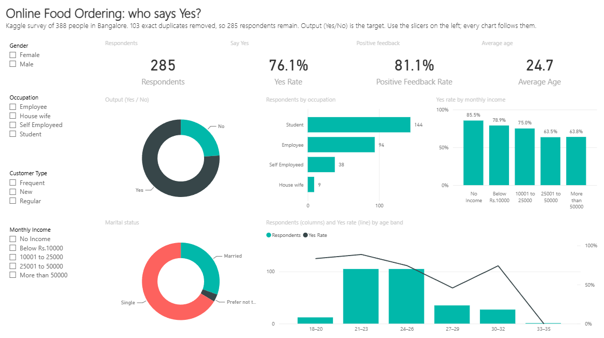 | 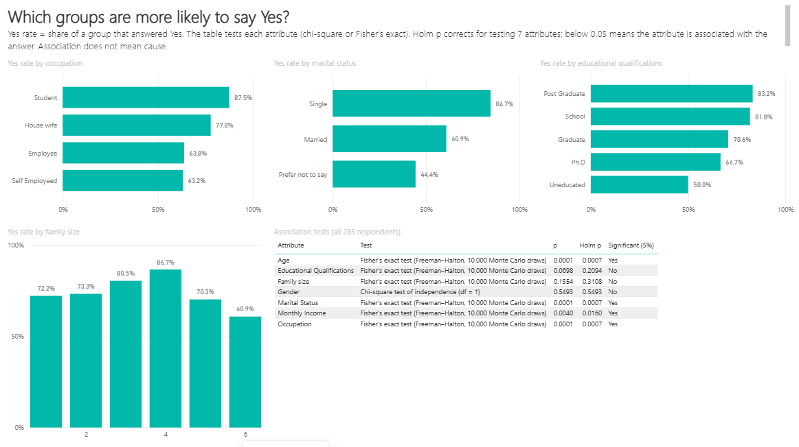 |
| 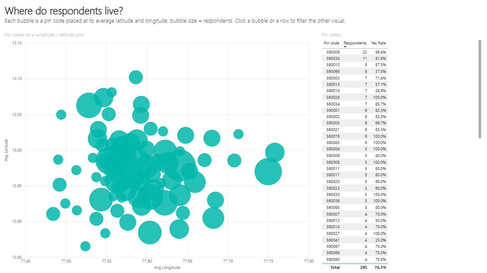 | 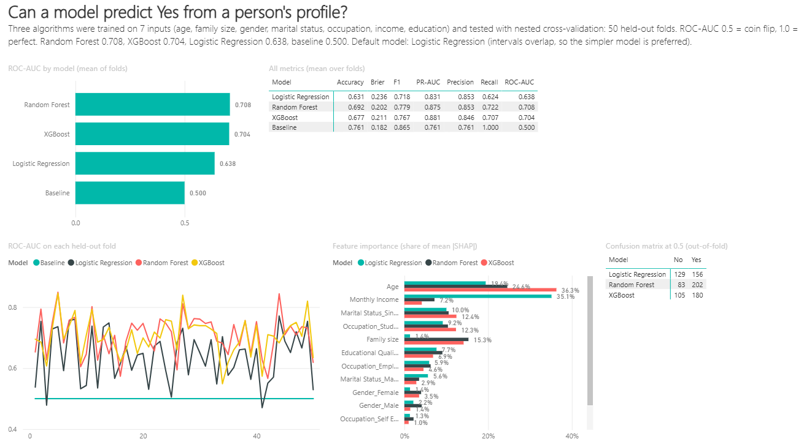 |
| 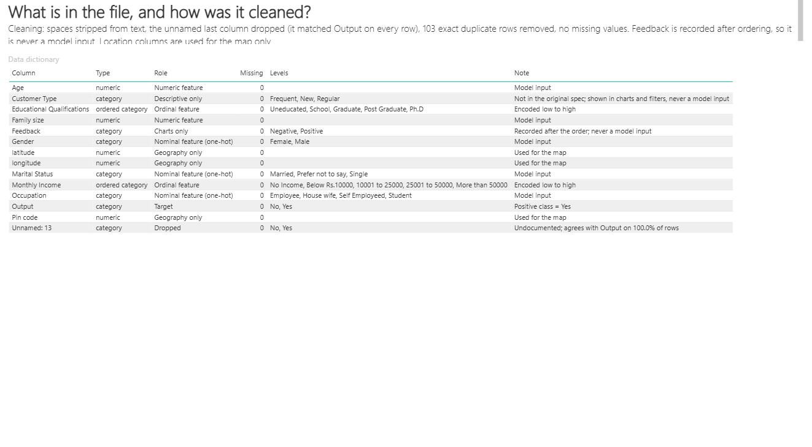 | |

## Screenshots

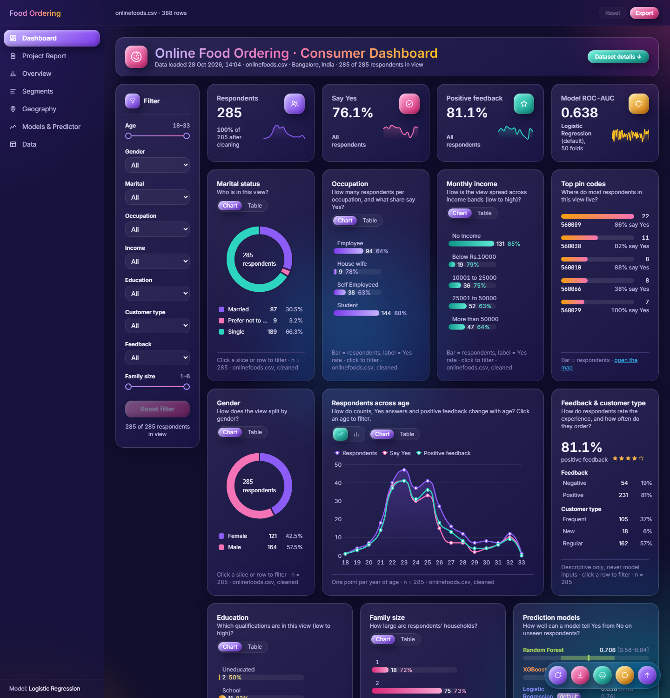

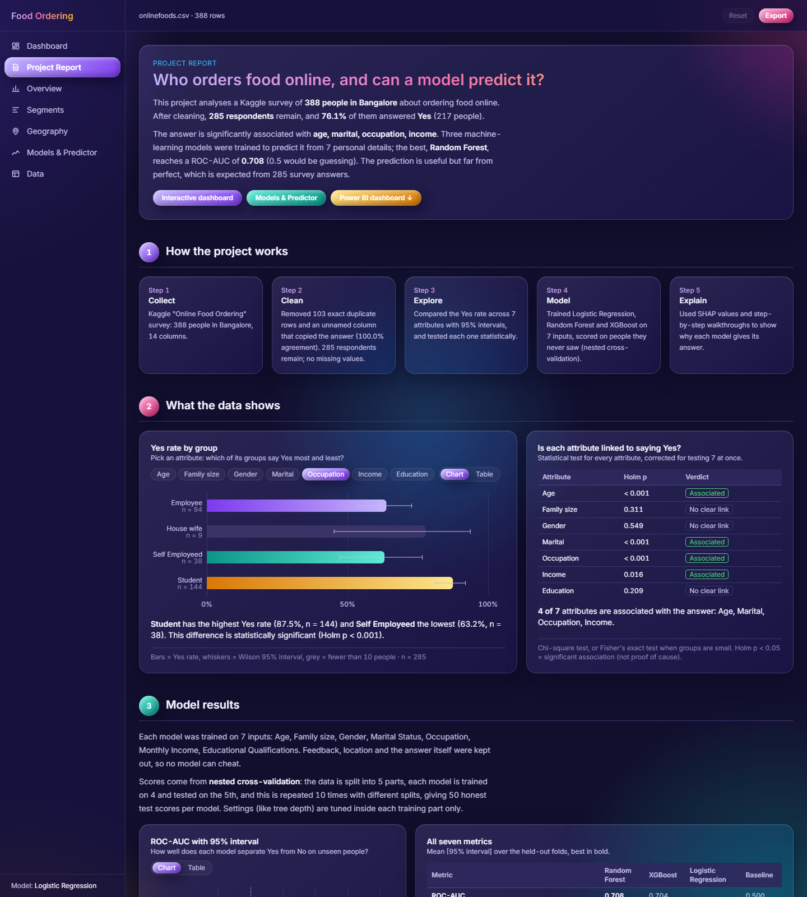

| | |
|---|---|
| 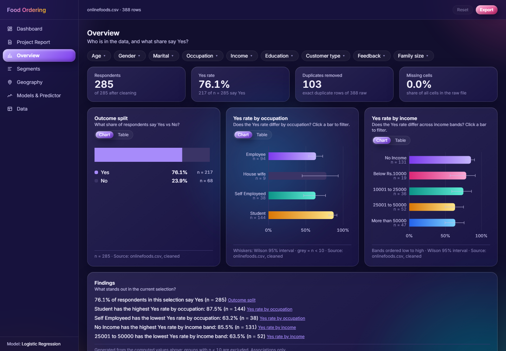 | 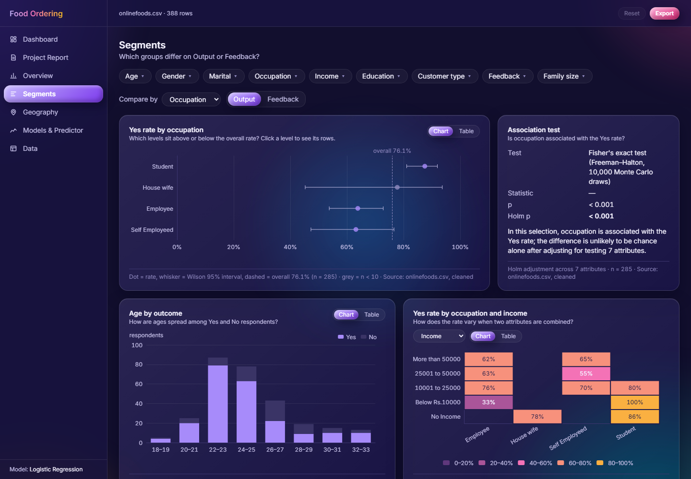 |
| 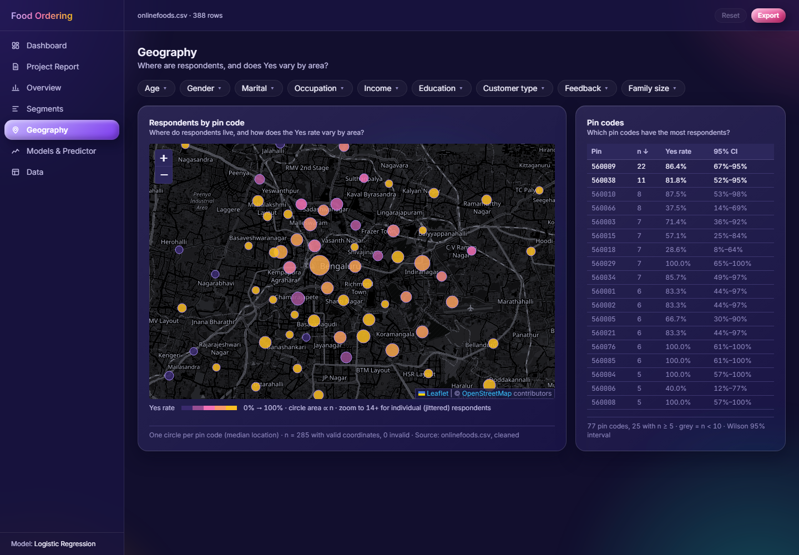 | 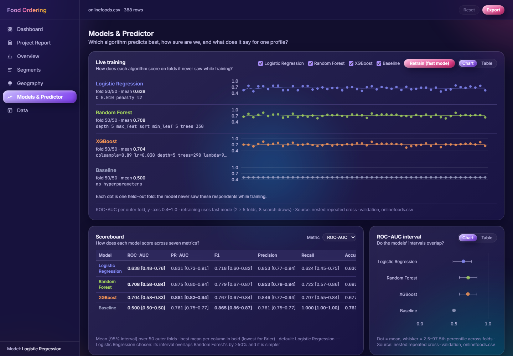 |
| 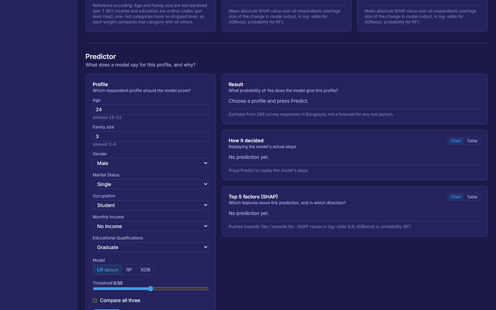 | 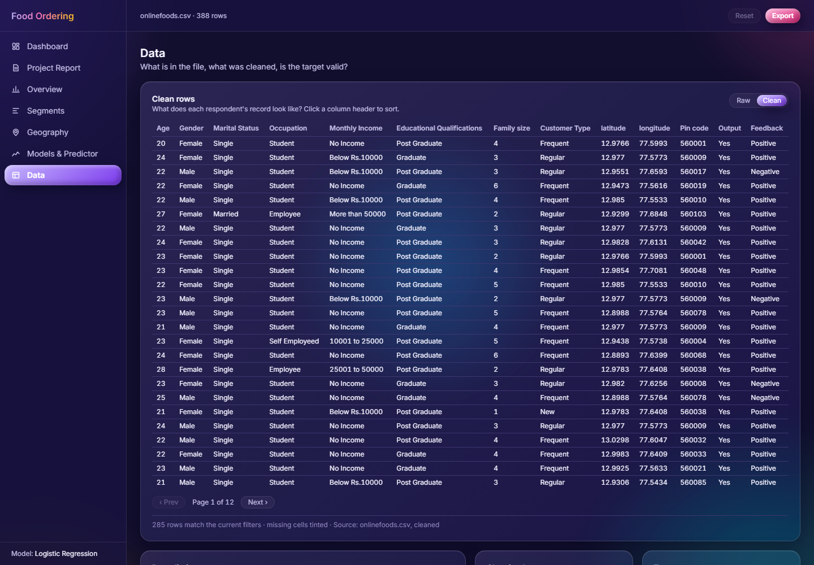 |
